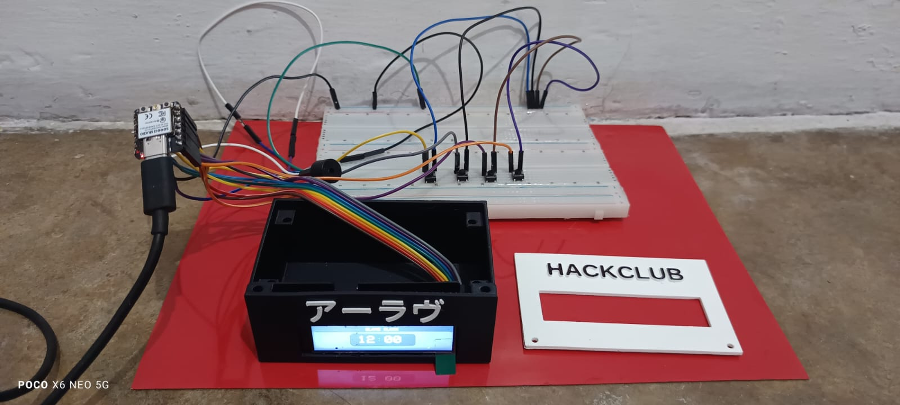
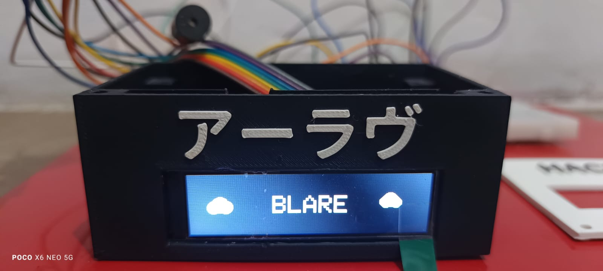

# Alarm Clock

A custom 4-key alarm clock built around the Seeed XIAO ESP32-C3 and a 2.25 inch TFT display.

The idea was to make a small, simple alarm clock with a custom PCB and a 3D printed enclosure instead of putting everything together with loose wires.

---

# The Idea

I wanted to build something that would let me learn the complete hardware design process, from making a schematic and PCB to designing a case around the actual hardware.

For this project, I decided to keep the design simple:

- 4 mechanical keys
- 2.25 inch TFT display
- Seeed XIAO ESP32-C3
- Piezo buzzer
- Custom PCB
- Custom 3D printed enclosure

**PCB**

 

**Schematic**

**Enclosure**

---

# Controls

SW1 - Enter time/alarm setting/switch between hour and minute

SW2 - Stop ringing alarm/increase selected value

SW3 - Decrease selected value

SW4 - Switch between Clock and Alarm/save and exit

---

# Hardware

Controller - Seeed Studio XIAO ESP32-C3

Display - 2.25-inch ST7789P3 TFT display

Input - Four mechanical keyboard switches are used as the main controls.

Sound - A passive buzzer connected to the XIAO ESP32-C3 is used for interface feedback and the alarm.

---

# AI Uses

AI is used for: 
- PCB design assistance
- Circuit troubleshooting
- CAD/enclosure design guidance
- Project organization

---

# Development Status

**The design and prototype are completed. The final PCB has been designed and ordered, but the components are currently connected using temporary breadboard wiring because the PCB has not been delivered yet.**

**The final PCB assembly will be completed once the board arrives.**

---

# Working Prototype

 

---